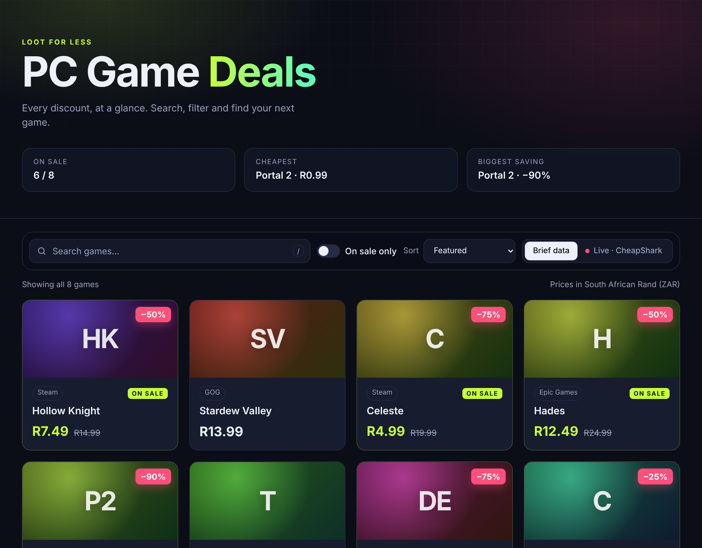

# 🎮 PC Game Deals

[](https://github.com/SizanobuhleZulu/pc-game-deals/actions/workflows/tests.yml)

A small web app for browsing PC game deals. You can search them, filter to games on sale, sort by price or discount, and switch to **live deals from the CheapShark API**, converted to Rand at today's exchange rate.

**🔗 Live demo:** https://sizanobuhlezulu.github.io/pc-game-deals/

Built with **plain JavaScript, HTML and CSS**. The app has **no runtime dependencies**, no build step and no framework. The only installed packages are dev tools for testing (Playwright, TypeScript).



---

## Quick start

You need [Node.js](https://nodejs.org) 18 or newer (only for the tests and the demo).

```bash
git clone https://github.com/SizanobuhleZulu/pc-game-deals.git
cd pc-game-deals

npm test          # 13 unit tests (Node's built-in test runner, nothing to install)
npm run demo      # Part A in the terminal (try: npm run demo -- "portal")
npm start         # serve the web page at http://localhost:3000

# Optional: browser tests and type-checking
npm install
npx playwright install chromium
npm run test:e2e  # 8 browser tests (APIs are mocked, so no internet needed)
npm run typecheck # TypeScript checks the JSDoc types in src/deals.js
```

> **Why do I need a server to open the page?** The page uses JavaScript modules (`import`/`export`). Browsers block those when a file is opened straight from disk (`file://`). Any static server works. If you don't have Node, run `python -m http.server 8000` and open http://localhost:8000.

---

## What's in each part

| Part | Where | What it does |
|------|-------|--------------|
| **A**: Thinking in code | [`src/deals.js`](src/deals.js), [`tests/deals.test.js`](tests/deals.test.js) | `getOnSaleGames`, `discountPercent`, `findCheapest`, `searchByTitle`, plus 13 unit tests |
| **B**: Put it on a page | [`index.html`](index.html), [`app.js`](app.js), [`style.css`](style.css) | A card for every deal. **Only discounted games** show the sale price, the struck-through old price, a `−X%` badge and the **ON SALE** tag. |
| **C**: Stretch goals | [`app.js`](app.js), [`tests/e2e/`](tests/e2e/page.spec.js) | All four, plus extras and 8 browser tests (see below) |
| **D**: This README | you're reading it | |

### Part A: the four functions

```js
getOnSaleGames(deals)         // → 6 games (Stardew Valley and Terraria are not discounted)
discountPercent(deal)         // Portal 2 → 90
findCheapest(deals)           // → Portal 2 at R0.99
searchByTitle(deals, "HADES") // → [Hades]
```

How the discount is worked out:

```
discount % = (normalPrice − salePrice) ÷ normalPrice × 100

Portal 2:  = (9.99 − 0.99) ÷ 9.99 × 100
           = 9.00 ÷ 9.99 × 100
           = 90.09…
           ≈ 90 %
```

| Game | Normal | Sale | Discount |
|------|-------:|-----:|---------:|
| Hollow Knight | R14.99 | R7.49 | 50% |
| Stardew Valley | R13.99 | R13.99 | — (not on sale) |
| Celeste | R19.99 | R4.99 | 75% |
| Hades | R24.99 | R12.49 | 50% |
| Portal 2 | R9.99 | R0.99 | **90%** |
| Terraria | R9.99 | R9.99 | — (not on sale) |
| Disco Elysium | R39.99 | R9.99 | 75% |
| Cuphead | R19.99 | R14.99 | 25% |

### Part C: stretch goals (all done)

- **Live search**: results update as you type. Press <kbd>/</kbd> anywhere to jump to the search box and <kbd>Esc</kbd> to clear it.
- **On-sale filter**: a toggle that hides games that aren't discounted.
- **Real data from CheapShark**: the *Live · CheapShark* button loads current deals with cover images, and each card links to the store.
  - **Prices in Rand:** CheapShark only returns US dollars, so I fetch today's USD → ZAR rate from the [Frankfurter API](https://frankfurter.dev/) and convert. The page shows the rate and its date. If the rate can't be fetched, it shows dollars and says so.
  - **Server-side search:** in live mode, search asks CheapShark for matching games across *all* its deals, not only the ones already loaded. It waits until you pause typing for 400 ms (a "debounce"), so typing "portal" sends one request instead of six.
  - **Load more:** deals load 24 at a time, with a *Load more deals* button.
  - **Caching:** API responses are kept in `sessionStorage` for 10 minutes, so switching back to live mode or revisiting doesn't call the API again.
- **Styling**: a dark "gaming" theme, generated cover art for the brief's games (each title always gets the same colour), hover effects, and loading skeletons.

**Extras I added:**

- **Sorting** by biggest discount, price (low to high, or high to low) and title.
- **Summary stats** at the top: how many games are on sale, the cheapest game and the biggest saving. These reuse the Part A functions.
- **Shareable URLs**: filters are saved in the address bar, so a link like `?q=portal&sale=1&sort=discount` opens exactly that view.
- **Graceful failure**: if CheapShark is down or blocked, the page shows a message and falls back to the brief's data instead of breaking.
- **Accessibility**:
  - a skip link
  - labels on every control
  - the result count is announced to screen readers
  - visible keyboard focus
  - animations are turned off for users who prefer reduced motion
- **Responsive**: works on phones.
- **Browser tests**: 8 Playwright tests check the real page: the ON SALE rules, filters, the URL, Rand conversion, Load more, debounced search, caching and both failure fallbacks. CheapShark and the exchange-rate API are mocked, so the tests are fast and never fail because of the network.
- **Type-checking**: `src/deals.js` has JSDoc types that TypeScript checks. Passing a string price such as `"10"` is caught before the code runs.
- **CI**: GitHub Actions runs the unit tests, the type-check and the browser tests on every push (the badge at the top).

---

## Choices I made, and why

1. **Vanilla JavaScript, no framework.** The brief says no framework is expected. With eight items, React would add a build step and dependencies without solving any real problem. Keeping it plain also means the logic is easy for a reviewer to read.
2. **Logic is separate from the page.** `src/deals.js` only contains *pure* functions: they take data in, return new data, and never change the original list or touch the page. The same file runs in Node (tests, demo) and in the browser (the page). `app.js` only handles the page.
3. **One `state` object drives the page.** Every control just updates `state`, and then `render()` redraws the page from it: filter → search → sort. That keeps the order of operations in one place (`visibleDeals()`), so the different filters can't get out of sync.
4. **Node's built-in test runner for the logic, Playwright for the page.** `node:test` means `npm test` works straight after cloning, with no `npm install`. Playwright and TypeScript are *dev* dependencies only: they're used to check the code but never shipped to the browser.
5. **`textContent`, never `innerHTML`, for game data.** Titles from CheapShark come from an outside source. Building cards with `textContent` means a malicious title can't inject HTML or scripts.
6. **An adapter for the API.** CheapShark's data has a different shape from the brief's. `normalizeCheapSharkDeal()` converts it once, so every other function works on both sources unchanged.
7. **Ignore stale responses.** Each live request gets a number, and any response that isn't from the newest request is ignored. Without this, a slow response for "por" could arrive after the response for "portal" and replace the right results with the wrong ones.
8. **JSDoc instead of converting to TypeScript.** I get type-checking on the logic without adding a build step, so the browser still runs the files exactly as written.

## Assumptions

- **"On sale"** means `salePrice < normalPrice`, exactly as the brief says. A price equal to normal (Stardew Valley, Terraria) is not a sale.
- **Discounts are rounded to the nearest whole percent.** Portal 2's 90.09% shows as 90%.
- **"Cheapest game"** means the lowest price you'd pay *right now* (`salePrice`), across *all* games, not only those on sale. If two games tie, the first one in the list wins, so the result is predictable.
- **Search** matches anywhere in the title, ignores capital letters and extra spaces, and an empty search shows everything.
- **Bad data:** a normal price of 0 gives a 0% discount instead of dividing by zero. A price that isn't a number throws an error, so bad data shows up immediately instead of silently.
- **Currency:** the brief's prices are labelled Rand, so they're shown as `R`. CheapShark only returns **US dollars**, so live prices are converted with that day's rate and rounded to cents. I chose a live rate instead of a hard-coded one, because a fixed rate would quietly go out of date. Discount percentages are the same in either currency.
- **Live mode filters and sorting** apply to the deals loaded so far. Search is the exception: it goes to CheapShark's server.

## Obstacles and how I solved them


- **CheapShark's data isn't shaped like the brief's.** Prices come back as *strings* (`"4.99"`), in USD, and the store is a number (`storeID: "1"`), not a name. I fetch `/stores` once to build an ID → name lookup and convert each deal with `normalizeCheapSharkDeal()`. A test covers this conversion.
- **The page was blank when opened straight from disk.** Browsers block ES modules over `file://`, so the page has to be served (see Quick start).
- **A test caught my own mistake.** I first assumed Stardew Valley (R13.99) was the most expensive game. The "price high to low" test failed because Cuphead (R14.99) is. The code was right and my expectation was wrong, which is exactly why the tests are there.
- **The live API can fail** (network down, firewall, rate limit). I added a fallback to the local data with a clear message, rather than an empty page.
- **Browser tests that don't depend on the internet.** Calling the real APIs from tests would make them slow and flaky. Playwright's `page.route()` lets each test return fake API responses, so I could also test the failure cases on purpose.
- **Fast typing caused extra requests and out-of-order results.** Fixed with a 400 ms debounce and by ignoring stale responses (see choice 7).

## Resources used

- [MDN Web Docs](https://developer.mozilla.org/): `Array.prototype.filter/reduce/sort`, `<template>`, `URLSearchParams`, `fetch`
- [Node.js test runner docs](https://nodejs.org/api/test.html)
- [CheapShark API docs](https://apidocs.cheapshark.com/)
- [Frankfurter exchange-rate API](https://frankfurter.dev/)
- [Playwright docs](https://playwright.dev/): especially `page.route()` for mocking
- [TypeScript: JSDoc reference](https://www.typescriptlang.org/docs/handbook/jsdoc-supported-types.html)
- **Claude (AI assistant)**: helped me plan the structure, draft the code, and review edge cases. I went through every function and can explain how and why it works.
  <!-- ✏️ Be specific and honest here: say what you used AI for and what you did yourself. -->

## Time taken

About **2 hours 20 minutes** in total, over two sessions:

| Activity | Time |
|----------|------|
| Reading the brief and planning | 10 min |
| Part A: functions and unit tests | 15 min |
| Parts B + C: page, search, filters, live API | 35 min |
| GitHub setup and deployment | 20 min |
| Reviewing and testing all the code until I could explain every part | 1 h |

I used Claude to write code quickly. I spent the rest of my time understanding it, testing it and checking the edge cases.

## What I'd do differently with more time

- **Cancel old requests instead of ignoring them.** Stale responses are ignored now, but the requests still finish in the background. `AbortController` would cancel them and save bandwidth.
- **Send sorting and filters to the API too.** In live mode, sort and "on sale only" apply to the loaded pages. CheapShark supports sorting and filtering on its side, which would sort across *all* deals.
- **A small backend proxy.** It would share one cache between all users, protect against CheapShark's rate limits, and keep any future API keys out of the browser.
- **More filters:** by store and by price range.
- **A wishlist with price alerts**, saved in the browser.
- **Automated accessibility checks** (axe) in CI, plus testing with a real screen reader such as NVDA.

---

## Project structure

```
pc-game-deals/
├── index.html              Page markup + card <template>
├── style.css               Styling (dark theme, responsive, reduced-motion)
├── app.js                  State, rendering, events, live data (search, paging, cache, currency)
├── src/
│   ├── data.js             The 8 deals from the brief
│   ├── deals.js            Part A: pure functions (shared by Node + browser)
│   └── demo.js             Part A in the terminal
├── tests/
│   ├── deals.test.js       13 unit tests
│   └── e2e/page.spec.js    8 browser tests (Playwright, mocked APIs)
├── playwright.config.js    Browser-test setup
├── jsconfig.json           Type-checking setup
└── .github/workflows/      CI: unit tests, type-check and browser tests on every push
```